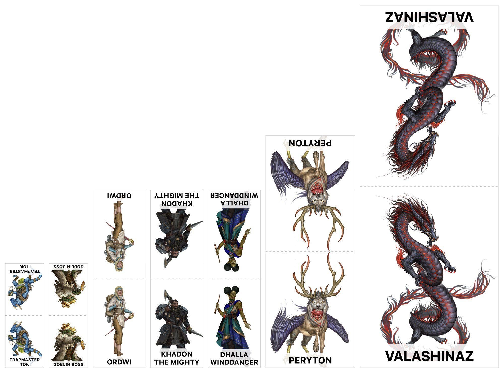
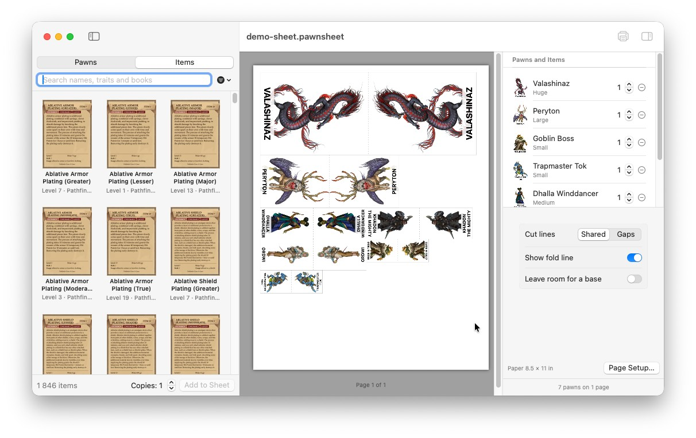

# Pawn Shop

[](https://github.com/scooper4711/pawn-shop/actions/workflows/ci.yml)
[](https://sonarcloud.io/summary/new_code?id=scooper4711_pawn-shop)
[](https://sonarcloud.io/summary/new_code?id=scooper4711_pawn-shop)
[](https://github.com/scooper4711/pawn-shop/releases)
[](https://github.com/scooper4711/pawn-shop/releases)
[](#requirements)
[](./LICENSE)

Do you have pawn PDFs you never print because the double-sided layout is so hard to line up? And when you
do get it to work, needing six goblins means printing the goblins' page six times, along with the other 29
pawns on it that you don't want.

Pawn Shop is an unofficial Mac app for Pathfinder and Starfinder that fixes both. Give it the pawn PDFs you
own, or import them all from [Scrollkeeper](https://github.com/scooper4711/scrollkeeper). It reads Paizo's
pawn boxes, Battle Cards and Starfinder Second Edition's round tokens, and builds a library of pawns.
Search for exactly the ones you want, add as many of each as you need, and they all print together on as few
sheets as possible.

The best part: it prints single-sided. Each pawn is one strip, its front below and its back above it upside
down, head to head. Cut it out and fold it at the heads. It is easier to print, and the folded pawn is two
sheets thick, so it stands up better. If you have a 3D printer, the [pawn bases](#pawn-bases) that come with
the app fit folded pawns, with a slightly curved slot that keeps them standing straight.

A creature without a pawn, because it only appears as art in a scenario or a newer book, can have one too:
make it from any picture, such as the art [Pluck](https://github.com/scooper4711/pluck) gets out of a
scenario PDF. Pawn Shop also prints item cards to hand players with the potion, elixir or scroll they were
given, so they remember to use it, and spell cards, so they remember what their spells do, whether they come from
a scroll, a wand or their own repertoire.

It is free and open source, and it works only with PDFs you bought: it contains no pawns or creature art of
its own.



*Printed strips: fold each at the heads and stand it in a pawn base. These are custom pawns made from art
Paizo has published on its blog (see [Sample art](#sample-art)); Paizo's pawns print the same way.*



*The library on the left (here Pathfinder and Starfinder item cards; the Pawns tab holds the pawns), the sheet
as it will print in the middle, pawns and an item card together, and the sheet's contents and cut lines on the
right.*

## Features

- Imports every pawn, token and Battle Cards PDF that
  [Scrollkeeper](https://github.com/scooper4711/scrollkeeper) has downloaded in one go, or any PDF you choose
  or drop on a window.
- Finds each pawn from its cut outline, names it from its label, sizes it (small, medium, large, huge) and
  turns it upright. Pawns printed on their side, with backs on the following page or with no back page at
  all, are handled. Pawns printed without cut outlines (the second half of the Monster Core Pawn Box, Dawn of
  Flame) are found from their pictures and labels, and drawn alone above their name, like Battle Cards.
- Turns round tokens into pawns: the token's art alone, without the page background, the cut line or the
  name printed on it, above the pawn's name on white. Tokens are named from the label on their back page or
  the name along their rim, and sized from the token (1" medium, 2" large, 3" huge).
- Turns Battle Cards into pawns: each card's creature alone, from the art side, standing above its name on
  white, named and sized from the stat side, with its traits (rarity and alignment left out) to search on.
  Decks in one PDF or in two (fronts and backs) are both read, for Pathfinder and Starfinder.
- Uses the sharpest art it has: a pawn whose painting a deck of Battle Cards also prints is drawn from the
  card, and a card already in the library keeps its art when the pawn box comes later.
- Stores copies of the same art once, also when another product reprints them, and keeps pawns that share
  a name but not their art (first and second edition, variants) side by side so you can pick.
- Search by name, product, trait or what the art shows, and filter by size, game, product or your own pawns.
- Optional tagging by a vision model running on your Mac in [Ollama](https://ollama.com), which describes
  each pawn's art in keywords such as "woman, warrior, shield, scimitar" and suggests names for pawns printed
  without one.
- Sheets are documents: add pawns with a number of copies, see the pages as they will print, and save the
  sheet to print again later. Strips are packed upright or on their side, whichever needs fewer pages.
- Cut lines shared between strips (one cut separates two pawns) or gaps between them, and an optional fold
  line.
- Optional room for a base: blank paper below each face's foot, so the base's slot holds that instead of
  hiding the bottom of the name. The art keeps its size and the strip gets taller.
- Custom pawns from your own images, from small to gargantuan.
- Item cards for every Pathfinder and Starfinder item, at the size of Paizo's item decks (63 × 88 mm): the
  name and level, traits, description with the action icons, a table of stats (Level, Price, Bulk, Usage and
  Uses, then a weapon's, armor's or shield's own) and the source book. The art of an item deck you imported
  shows faintly behind the text. Cards and pawns share sheets.
- Spell cards for every Pathfinder and Starfinder spell, cantrip, focus spell and ritual, the same size: the
  name and rank, traits, the stats as the books print them (Traditions, Cast, Range, Area, Targets, Defense,
  Duration, and a ritual's cost, casters and checks), and the text with its Heightened entries. Damage is
  worked out for the spell's rank, so Acid Grip reads "1d6 persistent acid damage".
- All cards use the same text size, as Paizo's do. One that runs a little long is set slightly smaller; a long
  item or spell continues on a second or third card, each marked "Card 1 of 2", and copies print whole sets.
- Tells you when a new version is released, if you like: it checks when it opens (turn that off in Settings)
  and on Pawn Shop › Check for Updates….

## Artwork

The `Artwork/` folder is a private Git submodule ([toolkit-artwork](https://github.com/scooper4711/toolkit-artwork)).
Clone with `git clone --recursive`, or run `git submodule update --init` after cloning. Its contents are
licensed and not redistributable. Without access to it, the build still works and falls back to built-in
artwork.

## Requirements

macOS 15 or later. You need the pawn PDFs themselves: buy them from [paizo.com](https://paizo.com) and
download them from your account, or let [Scrollkeeper](https://github.com/scooper4711/scrollkeeper), a
library manager for your Paizo purchases, download them.

## Installing a release

Download the disk image from the [releases page](https://github.com/scooper4711/pawn-shop/releases), open
it and drag Pawn Shop to Applications.

The app is not notarized by Apple, so macOS blocks it the first time:

1. Open Pawn Shop once. macOS says it cannot be opened; click Done.
2. Open System Settings › Privacy & Security and scroll down to the message about Pawn Shop.
3. Click Open Anyway and confirm.

After that it opens normally.

## Using Pawn Shop

- **Import:** Library › Import from Scrollkeeper imports every pawn, token and Battle Cards PDF that
  [Scrollkeeper](https://github.com/scooper4711/scrollkeeper)
  downloaded and that is not in the library yet. Library › Import PDF… (⇧⌘I), or dropping PDFs on a window,
  imports others. The import summary lists the pawns added, the pawns that now use sharper art from Battle
  Cards, and any PDF where nothing was found. A PDF whose file name does not mention Starfinder counts as
  Pathfinder, so rename such a file before importing it. Battle Cards are recognized by "Battle Cards" in the
  file or folder name; for a deck in two PDFs (FRONT and BACKS), import either one and the other is read too.
- **Find:** search by name, product, trait or tag, and filter by size, game, product or custom pawns.
  Right-click a pawn to rename or remove it. Select a pawn and press Space to see it large, front and back,
  with its traits and tags;
  the arrow keys move through the library, and Space or a click outside closes it.
- **Name:** some products print no names. Their pawns take the name of the same art in another product, or
  wait for you under Library › Review Unnamed Pawns…, with a suggested name when tagging is on.
- **Build a sheet:** File › New makes a sheet. Double-click a pawn, or set the copies and press Add to Sheet.
  The middle of the window shows the pages as they will print; click a strip and press Delete to remove a
  copy, or change copies in the inspector on the right, where the cut style is chosen too. Turn on Leave room
  for a base there when the base hides the bottom of the name: it adds 6 mm, the depth of the slot in the
  included bases, below each foot, and you can change the amount.
- **Print:** File › Page Setup… (⇧⌘P) picks the paper, then File › Print… (⌘P) or Export PDF… (⌘E). Print at
  100% scale (Actual Size), so the pawns fit their bases.
- **Item cards:** switch the library from Pawns to Items at its top. Consumables are listed first; the filter
  menu picks the game, kind and level. Double-click an item, or set the copies and press Add to Sheet; Space
  shows the card large. Import item decks like any other PDF (from Scrollkeeper, or Import PDF…, where a deck
  sold as pictures is chosen as its folder) to add their art to the cards.
- **Spell cards:** switch the library to Spells. The filter menu picks the game, kind (spells, cantrips, focus
  spells, rituals), rank and tradition. Add them like items; a tile says when a spell takes more than one card,
  and Space shows all of its cards. To save ink, turn off Settings › Item Cards › Print card backgrounds; cards
  then print on white. Smallest text size, in the same place, sets how far text may shrink to save a card
  (6.25 pt unless changed; 5.5 pt fits most spells on one card).
- **Your own art:** Library › Add Custom Pawn… (⌥⌘N): choose, drop or paste an image, name it, pick a size,
  and drag the preview to place the art. The back is the front mirrored. To use a creature's art from a
  scenario or book PDF, open the PDF in [Pluck](https://github.com/scooper4711/pluck) and drag or copy the
  picture from there.

### Tagging

Tagging is optional and runs entirely on your Mac. Install [Ollama](https://ollama.com), start it, and pull
the model:

```sh
ollama pull gemma3:12b
```

While Pawn Shop runs, it then tags the pawns in the background, about 8 seconds a pawn, starting with those
on screen. A progress bar below the library shows how far it has come (hover over it for the numbers), and
Settings › Tagging shows how many are tagged. Turn off Tag pawns with AI there to stop tagging, and turn it
back on to pick up where it left off. Without Ollama, pawns stay untagged and Library › Tag New Pawns tries again. To use another
vision model, which tags every pawn again:

```sh
defaults write io.github.scooper4711.PawnShop TaggingModel <model>
```

## Not handled yet

- Pages that are a single picture with no text (the second half of the NPC Core Pawn Box); the import summary
  names them.
- Terrain collections with rectangular outlines (Dungeon Decor, Traps & Treasures, Tech Terrain).

These import with fewer pawns, or none; the import summary names the PDFs where nothing was found. The NPC
Core Battle Cards print the creatures that pawn box is missing.

When a new version of Pawn Shop reads PDFs better, importing from Scrollkeeper again reads the PDFs you
imported before and adds the pawns found anew, keeping your names and tags.

## Pawn bases

The disk image also holds a Pawn Bases folder: 3D-printable bases sized for the pawns, from medium to
gargantuan, ready to print as STL files labeled 1–4 or blank, with a slot test piece to find the slot width
that grips your paper. To make your own, open `pawn_base.scad` in [OpenSCAD](https://openscad.org) and set the
size, the label and how far the slot curves in its Customizer. See the folder's
[README](pawn-bases/README.md). The slot is 6 mm deep, which a sheet's Leave room for a base setting matches
by default, so the whole name stays in view.

## Tableside Toolkit

Pawn Shop is part of the Tableside Toolkit, free Mac apps for running Pathfinder and Starfinder games in person;
Turnkeeper and Field Guide run on the iPad too. Like any good toolkit, each one grants a +1 item bonus to game
prep.

- [Scrollkeeper](https://github.com/scooper4711/scrollkeeper) keeps your Paizo library in order and downloads your
  purchases.
- [Pluck](https://github.com/scooper4711/pluck) gets the art, text and stat blocks out of a PDF.
- **Pawn Shop** prints just the pawns you need, single-sided, from your pawn PDFs.
- [Mapsmith](https://github.com/scooper4711/mapsmith) prints battle maps at true scale on ordinary paper.
- [Turnkeeper](https://github.com/scooper4711/turnkeeper) builds encounters and runs initiative at the table, with
  the battle card of whoever's turn it is, on the iPad and the Mac.
- [Field Guide](https://github.com/scooper4711/field-guide) carries the Pathfinder and Starfinder compendium,
  offline, on the iPad and the Mac.

## Supporting the project

The app is free and always will be. If it saves you time and you would like to say thanks, you can leave a
tip on [Ko-fi](https://ko-fi.com/coop207627). A donation is entirely optional and unlocks nothing.

## Building

```sh
make app      # builds "build/Pawn Shop.app"
make run      # builds and launches the app
make install  # builds the app and moves it to /Applications
make test     # runs the unit tests
make lint     # runs SwiftLint
make coverage # runs the tests and enforces the coverage threshold
make items    # builds Generated/: the item list and the item cards' art
make dmg      # packages the app into a disk image
make release-dmg # builds the tagged version's disk image here and attaches it, if GitHub's build fails
make icon     # redraws Resources/AppIcon.icns
```

`pawn-bases/build.sh` renders every base and the slot test piece to `pawn-bases/stl/` with OpenSCAD (by default
from `/Applications/OpenSCAD-2021.01.app`; set `OPENSCAD` to use another copy). It takes a minute or two.

Building needs Xcode 16 or later (Swift 6 toolchain). The app is ad-hoc signed.

Item and spell cards need `Generated/`, which `make items` builds and `make app` bundles; it is not in the
repository. It reads the [pf2e system](https://github.com/foundryvtt/pf2e) release named in `pf2e.release`, fetched into
`build/pf2e` (or a checkout of your own in `PF2E_REPO`), for the items and spells,
Paizo's Pathfinder-Icons font from the `Artwork` submodule (`ARTWORK`) for the action icons, and the Rexard UI packs from `~/git/rexard-packs` (`REXARD_PACKS`) for the cards'
parchment, frames and panels, which may be used inside the app but not published. Without it the app builds
and runs, and the Items list says how to get it. Release disk images are built on GitHub from the private
`toolkit-artwork` repository instead (`REXARD_PACKS=Artwork/rexard make items` does the same here). Every
Monday a workflow moves `pf2e.release` to pf2e's newest release; when that changes the imported items (their
fingerprint in `import.sha256`, which `make items` updates), it also tags the next patch version and builds its
draft release. `PAWN_SHOP_GENERATED` points a build run from the command line at a `Generated` folder.

Tests that read real pawn PDFs use `TestData/`, which is not committed because the PDFs are copyrighted.
Copy or link your own pawn PDFs there to run them; they are skipped when the folder is empty.

To try the app without touching your library, set `PAWN_SHOP_LIBRARY` to another folder. With
`PAWN_SHOP_SNAPSHOT=<prefix>` the app also draws its windows to `<prefix>-*.png` a few seconds after launch:

```sh
open -n --env PAWN_SHOP_LIBRARY="$PWD/tmp/library" --env PAWN_SHOP_SNAPSHOT="$PWD/tmp/snap" \
     -a "$PWD/build/Pawn Shop.app"
```

The code is in three parts: `Sources/ItemCatalogImport` (run as `ItemImport`) builds the item list,
`Sources/PawnShopCore` holds all the logic and is unit tested (`Extraction` reads
pawn PDFs, `Library` keeps the library, `Sheet` lays out, draws and exports sheets), and `Sources/PawnShop` is
the SwiftUI app.

## Where things are stored

| What | Where |
|---|---|
| Library, tags | `~/Library/Application Support/Pawn Shop/library.json` |
| Copies of the imported PDFs | `~/Library/Application Support/Pawn Shop/Sources/` |
| Tokens' art | `~/Library/Application Support/Pawn Shop/Tokens/` |
| Item art from decks sold as pictures | `~/Library/Application Support/Pawn Shop/Items/` |
| Custom pawns' images | `~/Library/Application Support/Pawn Shop/Custom/` |
| Sheets | wherever you save them, as `.pawnsheet` files |

## Documentation

The requirements and design are in [`docs/specs/pawn-shop`](docs/specs/pawn-shop).

## Sample art

The pawns in the pictures above are custom pawns made from art Paizo has published on its blog, used under
Paizo's [Community Use Policy](https://paizo.com/licenses/communityuse):

- Ordwi: Firat Solhan ([Paizo blog](https://paizo.com/blog/fear-in-a-handful-of-rust))
- Khadon the Mighty: Sandra Posada ([Paizo blog](https://paizo.com/blog/digging-up-some-highhelm-authors))
- Dhalla Winddancer: Bruno Mello ([Paizo blog](https://paizo.com/blog/november-digital-adventure-previews))
- Trapmaster Tok: Denis Zhbankov ([Paizo blog](https://paizo.com/blog/november-digital-adventure-previews))
- Goblin Boss: Gunship Revolution ([Paizo blog](https://paizo.com/blog/meet-the-authors-of-npc-core))
- Peryton: Firat Solhan ([Paizo blog](https://paizo.com/blog/iconic-encounters-returning-home))
- Valashinaz: Firat Solhan ([Paizo blog](https://paizo.com/blog/february-digital-adventures-previews))

## License

Pawn Shop is released under the [MIT license](LICENSE). It uses no third-party libraries besides the
author's own [Tabletop Kit](https://github.com/scooper4711/tabletop-kit).

The item text on the cards comes from the [pf2e system for Foundry VTT](https://github.com/foundryvtt/pf2e)
and is used under the ORC License and the Open Game License 1.0a, whose notices ship with the app
(`Contents/Resources/Generated/Items/Licenses`). The cards' parchment, frames and panels are Rexard game dev
assets, licensed for use in the app. The action icons are Paizo's Pathfinder-Icons font, used under the
[Paizo Compatibility License](https://paizo.com/licenses/compatibility); it ships inside the app unaltered and is
not in this repository.

## Paizo notices

Pawn Shop uses trademarks and/or copyrights owned by Paizo Inc., used under Paizo's Community Use Policy
([paizo.com/licenses/communityuse](https://paizo.com/licenses/communityuse)). We are expressly prohibited from
charging you to use or access this content. Pawn Shop is not published, endorsed, or specifically approved by
Paizo. For more information about Paizo Inc. and Paizo products, visit [paizo.com](https://paizo.com).

Pathfinder and Starfinder are registered trademarks and copyrights of Paizo Inc.

The same notices are in the app, under Pawn Shop › About Pawn Shop. To report a problem or ask a question, open
an [issue](https://github.com/scooper4711/pawn-shop/issues).
